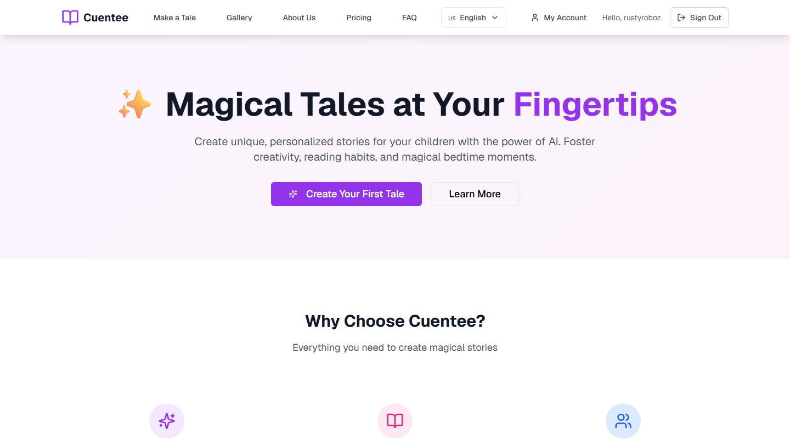
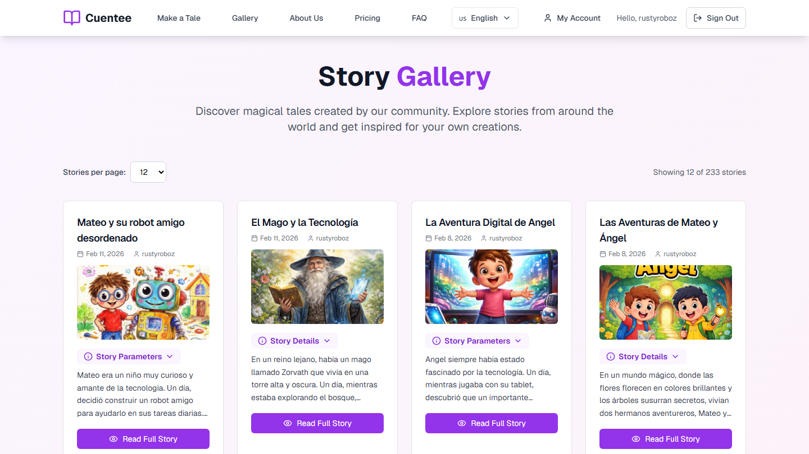
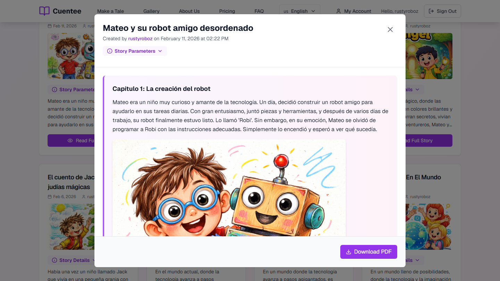
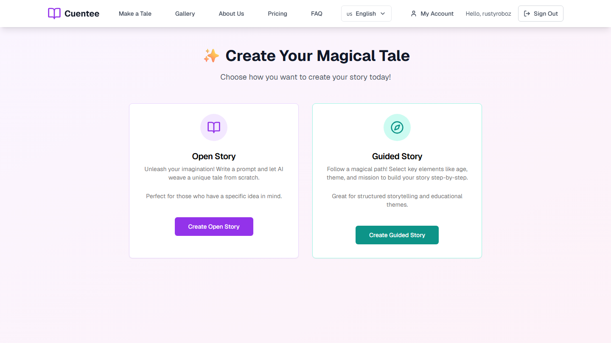
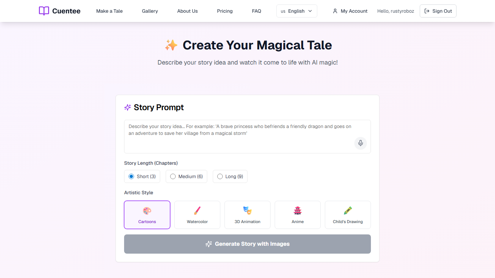
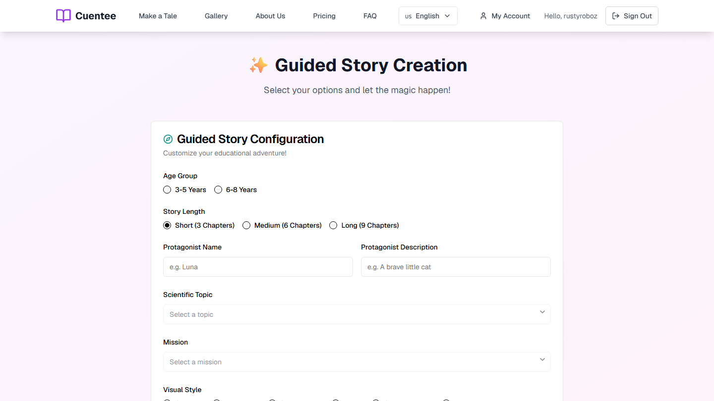

# Cuentee

AI-powered children's story generator for creating illustrated, multilingual tales.

[Live app](https://www.cuentee.com) | [Quick start](#quick-start) | [Architecture](#architecture) | [API](#api-endpoints)

## Screenshots

Screenshots were captured from `https://www.cuentee.com` on 2026-05-31 with a signed-in account.

| Home | Public gallery |
|:-:|:-:|
|  |  |

| Story modal | Story type selection |
|:-:|:-:|
|  |  |

| Open story creator | Guided story creator |
|:-:|:-:|
|  |  |

## Features

- Open story generation from a free-form prompt.
- Guided educational story generation with age group, protagonist, scientific topic, mission, visual style, language, and chapter count.
- AI-generated cover and chapter illustrations through OpenAI image models.
- Character consistency pipeline: the backend extracts character descriptions once, filters them per chapter, and injects the selected descriptions into image prompts.
- Multilingual UI and prompts for English, Spanish, French, German, Italian, and Portuguese.
- Supabase authentication with email/password and Google OAuth.
- Credit-based usage model with free credits and a `plus` plan refill job.
- Private account library, public gallery, story visibility controls, pagination, and story modal viewing.
- PDF generation and upload for generated stories.
- Optional real-time speech-to-text input through Speechmatics.

## Architecture

```text
Browser / Next.js app
  - Next.js 15 App Router
  - React 19, TypeScript, Tailwind CSS, Radix UI, Lucide icons
  - Supabase client auth and story queries
        |
        | REST + WebSocket
        v
FastAPI backend
  - /stories/generate-story-async
  - /stories/generate_guided_story_async
  - /tasks/{task_id}
  - /transcription/transcribe
        |
        | Celery task queue
        v
Celery worker + Redis
        |
        v
LangGraph story workflow
  1. Generate structured story with Groq GPT-OSS 120B
  2. Extract character visual descriptions
  3. Generate cover/chapter images with OpenAI image models
        |
        v
Supabase
  - PostgreSQL: stories, profiles
  - Auth: users and JWTs
  - Storage: images and PDFs
```

## Tech Stack

| Layer | Technology |
|---|---|
| Frontend | Next.js 15, React 19, TypeScript, Tailwind CSS, Radix UI, Lucide React |
| Backend | FastAPI, Python 3.11, Celery, Redis |
| Text AI | Groq `openai/gpt-oss-120b` via LangChain |
| Workflow | LangGraph |
| Image AI | OpenAI images: GPT Image 2.5 Flare / Sunburst, GPT Image 2, and legacy GPT Image / DALL·E models |
| Speech | Speechmatics WebSocket STT |
| Data/Auth | Supabase PostgreSQL, Auth, and Storage |
| PDFs | fpdf2 with bundled fonts |
| Deployment | Dockerfiles and Docker Compose configs for backend, worker, and frontend |

## Project Structure

```text
.
|-- api/                         FastAPI backend
|   |-- agents/                  LangGraph workflow, story schemas, image upload helpers
|   |-- celery_tasks/            Celery app and story generation task
|   |-- core/                    Environment config and auth dependencies
|   |-- prompts/                 Localized story, guided story, image, and character prompts
|   |-- routers/                 Stories, task status, and transcription routes
|   `-- services/                Supabase, user credits, and PDF services
|-- db/                          Base Supabase SQL schema
|-- docs/screenshots/            README screenshots captured from the live app
|-- frontend/                    Next.js application
|   |-- app/                     App Router pages
|   |-- components/              Forms, navigation, gallery, story modal/viewer, UI primitives
|   |-- hooks/                   Story generation polling hook
|   |-- lib/supabase/            Supabase clients and story/profile operations
|   `-- locales/                 UI translations
|-- tests/                       Pytest coverage for environment, story node, and image generation
|-- docker-compose.yml           Backend API and worker compose file
`-- .env.example                 Minimal local environment template
```

## Story Generation Flow

Open stories:

```text
Prompt + options
  -> POST /stories/generate-story-async
  -> Celery task
  -> LangGraph story generation
  -> character extraction
  -> image generation and upload
  -> PDF generation and upload
  -> Supabase story record
  -> client polls GET /tasks/{task_id}
```

Guided stories use the same Celery and LangGraph pipeline, but the backend first builds the story prompt from structured fields: age group, protagonist, scientific topic, mission, visual style, language, and chapter count.

## Character Consistency

The backend keeps character descriptions stable across images:

1. `character_extraction_node` reads the full generated story and creates concrete visual descriptions.
2. `_build_chapter_character_block` selects only the characters that appear in each chapter.
3. `make_image_prompt` appends the selected descriptions verbatim to the image prompt so they are not rewritten by another LLM call.

Preserve this invariant when editing `api/agents/story_agent.py` or `api/agents/utils.py`.

## Quick Start

### Prerequisites

- Python 3.11+
- Node.js 18+ for local frontend development
- Redis for Celery
- Supabase project
- OpenAI and Groq API keys
- Optional: Speechmatics API key for voice input

### Environment

The backend reads these variables:

```env
OPENAI_API_KEY=sk-...
GROQ_API_KEY=gsk_...
GROQ_MODEL=openai/gpt-oss-120b
SUPABASE_URL=https://your-project.supabase.co
SUPABASE_ANON_KEY=...
SUPABASE_SERVICE_ROLE_KEY=...
SUPABASE_PROJECT_REF=your-project-ref
REDIS_URL=redis://localhost:6379/0
STORAGE_BUCKET_NAME=cuentee_images
IMAGE_MODEL=gpt-image-2-2026-04-21
SPEECHMATICS_API_KEY=...
```

`GROQ_MODEL` selects the text model for story writing, character descriptions and
illustration prompt writing. It defaults to `openai/gpt-oss-120b` when unset or
blank. In Sliplane, you can set it on the API and worker services to select a
different Groq model, then save and redeploy both services. It does not change
`IMAGE_MODEL`, which selects the OpenAI model that generates the actual images.

Image generation is controlled exclusively by `IMAGE_MODEL` in the container
environment. Set **one** of the following values on both the API and worker
services in Sliplane (the worker generates the images):

```env
# GPT Image 2.5 Flare
IMAGE_MODEL=gpt-image-2.5-flare
```

```env
# GPT Image 2.5 Sunburst
IMAGE_MODEL=gpt-image-2.5-sunburst
```

For reproducible versions, use `gpt-image-2.5-flare-2026-09-08` or
`gpt-image-2.5-sunburst-2026-09-08`. To return to the previous model, set
`IMAGE_MODEL=gpt-image-2-2026-04-21`. No other model variable is needed.
All GPT Image options use `quality=low`, `size=1024x1024`, and base64 uploads.
The text model remains controlled separately by `GROQ_MODEL`.

Save and **redeploy/recreate both containers** after changing their environment.
Deploy the code with GPT Image 2.5 support first; older builds do not recognize
these values. No source edit or new image build is needed for subsequent model
switches. Check the worker startup log for
`Image generation configuration: IMAGE_MODEL=...`.

With Docker Compose, put the chosen `IMAGE_MODEL` in the Compose `.env` file or
export it in the shell, then run `docker compose up -d --force-recreate api worker`.
Compose passes the same setting to both services instead of forcing DALL·E 3.
Unset or blank values default to `gpt-image-2-2026-04-21`; unsupported values fail
at startup with the list of accepted models rather than silently using another.
Legacy per-story `model` overrides are ignored, including in previously queued jobs.

Other accepted values are `gpt-image-2`, `gpt-image-1.5`, `gpt-image-1-mini`,
`gpt-image-1`, `dall-e-2`, and `dall-e-3` (also `dalle-2` / `dalle-3`).
Legacy identifiers are retained for compatibility; provider availability and
account access still apply. Official model references:
[Flare](https://developers.openai.com/api/docs/models/gpt-image-2.5-flare) and
[Sunburst](https://developers.openai.com/api/docs/models/gpt-image-2.5-sunburst).

Older deployments with `GROQ_MODEL=llama-3.3-70b-versatile` are migrated to
`openai/gpt-oss-120b` with a warning. Other explicit model choices are preserved.

If the frontend still reports `model_not_found` for Llama after merging:

1. In Sliplane, check that **both API and worker** deploy from `main` and that the
   worker uses `api/celery_tasks/Dockerfile.worker` with the repository root as
   its build context.
2. Set `GROQ_MODEL=openai/gpt-oss-120b` in both services, then **save and redeploy**
   them. Restarting the existing container does not rebuild its code.
3. Verify the worker startup log contains `Worker configuration: Groq
   model=openai/gpt-oss-120b` and compare `deployment commit` with the deployed
   commit in Sliplane (it is `unknown` outside Sliplane).
4. Generate a **new** story. A failed Celery task retains its previous error;
   polling that task again does not rerun it with the updated code.

The frontend displays the worker's task failure; changing frontend image-model
settings cannot fix a Groq text-model error.

The frontend reads these variables:

```env
NEXT_PUBLIC_SUPABASE_URL=https://your-project.supabase.co
NEXT_PUBLIC_SUPABASE_ANON_KEY=...
NEXT_PUBLIC_FASTAPI_URL=http://localhost:8000
```

`.env.example` is a minimal starting point; add the backend Supabase and Redis values before running generation locally.

### Redis Cloud database replacement

The API health check, Celery broker and Celery result backend share `REDIS_URL`.
For local development it defaults to `redis://localhost:6379/0`; hosted services
must supply their Redis Cloud URL as a deployment secret.

The replacement Cuentee instance is:

- Host: `redis-13424.c135.eu-central-1-1.ec2.cloud.redislabs.com`
- Port: `13424`
- Username: `default`
- Database: `0`
- Scheme: `redis://`, matching the connection supplied for this instance

Use `.env.redis-cloud.example` as the connection template and replace `PASSWORD`
with the password from Redis Cloud. URL-encode reserved characters in passwords.
Keep the complete URL in your hosting provider's secret/environment settings or
an ignored local `.env` file, never in Git.

When replacing a deleted database:

1. Replace the existing `REDIS_URL` secret in **both** the API and Celery worker
   services. Reusing the database name does not preserve its endpoint or password.
2. Restart/redeploy both services so they discard the previous connections.
3. Verify the API startup Redis check and worker broker connection succeed.
4. Generate a test story and verify that its task completes.

Merging this change does not update deployment secrets. The new database also
does not restore queued tasks or task results from the deleted instance.

### Backend and Worker

```bash
pip install -r api/requirements.txt
redis-server
uvicorn api.main:app --reload
celery -A api.celery_tasks.app worker --loglevel=info
```

Generation endpoints enqueue Celery tasks. Redis and the worker must be running or story generation will not complete.

### Frontend

```bash
cd frontend
npm install
npm run dev
```

The frontend runs at `http://localhost:3000` by default.

### Docker

The root `docker-compose.yml` builds the FastAPI API and Celery worker. It expects Redis and Supabase configuration through environment variables.

```bash
docker-compose up --build
```

The frontend has its own Dockerfile and compose file under `frontend/`.

## API Endpoints

| Method | Endpoint | Description |
|---|---|---|
| `GET` | `/` | Backend health check |
| `POST` | `/stories/generate-story-async` | Enqueue open story generation |
| `POST` | `/stories/generate_guided_story_async` | Enqueue guided story generation |
| `GET` | `/tasks/{task_id}` | Read Celery task status and result |
| `WS` | `/transcription/transcribe` | Speechmatics transcription WebSocket |

Story generation endpoints require a Supabase Bearer token and available credits.

## Database

The base schema in `db/schema.sql` defines:

- `stories`: generated story content, prompt, type, metadata, timestamps, and RLS policies for user-owned records.
- `profiles`: user credits, plan, plus refill timestamps, and signup trigger.

Additional SQL scripts in `frontend/scripts/` extend the deployed schema with fields and policies used by the UI, including usernames, story visibility, public gallery access, and profile fixes.

## Tests

```bash
pytest
```

Real Groq integration coverage is opt-in:

```bash
RUN_REAL_API_TESTS=true pytest tests/test_agents.py::test_real_story_generation_integration -v
```

## License

MIT
